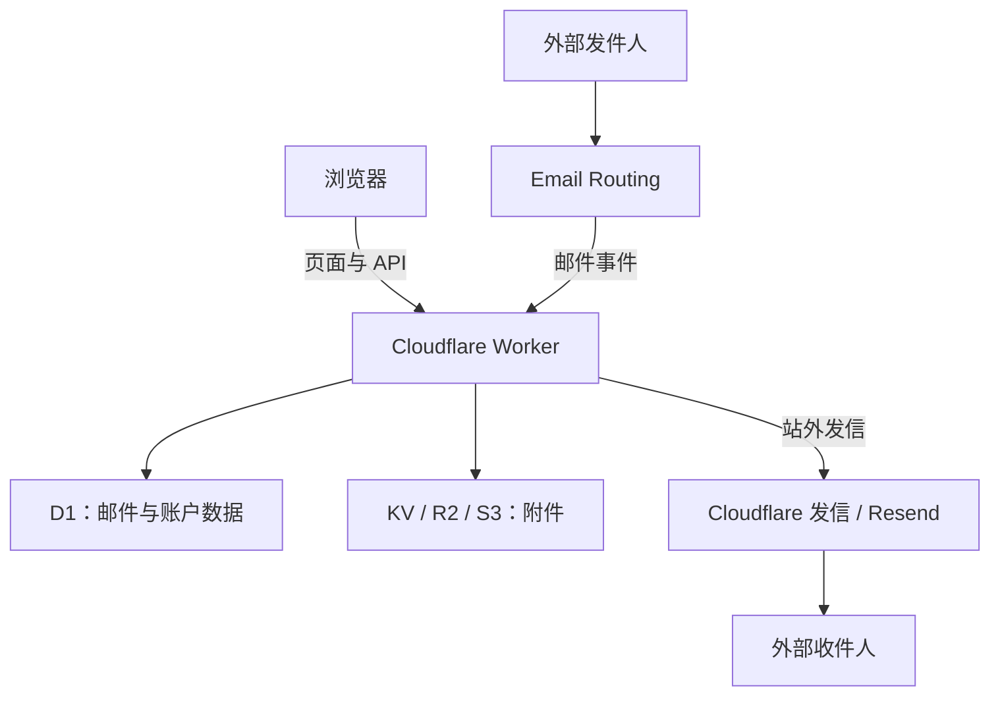

# 架构与功能边界

[文档中心](README.md) · [配置说明](configuration.md) · [上线验收](acceptance.md)

本文根据当前分支源码说明请求、收件、发件和附件存储的关系，不代表所有可选功能已在维护者实例启用。

## 目录

- [运行架构](#运行架构)
- [请求入口](#请求入口)
- [收件流程](#收件流程)
- [发件选择](#发件选择)
- [附件存储](#附件存储)
- [功能边界](#功能边界)

## 运行架构

Web 访问、收件路由和站外发信是不同链路。网站正常打开不能证明邮件路由已启用；站内互发成功也不能证明外部发信服务可用。

## 请求入口

[Worker 入口](../mail-worker/src/index.js) 分派三类 HTTP 请求：

| 路径 | 处理方式 |
| --- | --- |
| `/api/*` | 移除 `/api` 前缀后交给 Hono API |
| `/static/*`、`/attachments/*` | 由 KV 对象服务读取 |
| 其他页面路径 | 交给 Workers Assets，读取前端构建产物 |

Worker 还提供 `email` 邮件事件入口与 `scheduled` 定时任务。定时任务负责维护性工作，不替代收件路由。

## 收件流程

[邮件处理入口](../mail-worker/src/email/email.js) 先读取系统设置，检查收信开关及内容过滤，再解析邮件并匹配邮箱账户。

1. 优先按完整收件地址匹配账户。
2. 完整地址不存在时，尝试匹配去掉 `+tag` 的基础地址。
3. 仍无账户时，按“无人收件”设置拒收或保存为无人收件邮件，不会自动创建账户。
4. 对已匹配账户检查适用的域名与收信权限。
5. 保存邮件和附件，再按配置执行 Telegram、邮件转发或 Webhook 通知。

例如 `name+shop@example.com` 可以回退到已存在的 `name@example.com`。这属于地址匹配机制，不是创建新用户。Cloudflare 路由也必须允许该地址进入 Worker。

## 发件选择

[发件服务](../mail-worker/src/service/email-service.js) 会先检查系统开关、角色权限、额度与发件账户归属，再选择投递路径：

| 收件范围 | 当前源码的路径 |
| --- | --- |
| 所有收件人均属于系统配置域名 | 站内处理，直接写入邮件数据 |
| 包含站外收件人，且存在 `env.email` | 优先调用 Cloudflare 发信绑定 |
| 包含站外收件人，无 `env.email` | 使用发件域名对应的 Resend Token |
| 包含站外收件人，无可用发信服务 | 返回缺少发信服务的错误 |

配置了 Cloudflare 发信绑定但其调用失败时，当前这段代码不会自动改用 Resend 重试。不要把同时配置两个服务理解为自动故障切换。

第三方服务接收了发送请求，也不等于对方一定在收件箱看到邮件；需要检查实际投递结果。

## 附件存储

[存储服务](../mail-worker/src/service/r2-service.js) 的选择优先级如下：

| 优先级 | 条件 | 使用的服务 |
| :---: | --- | --- |
| 1 | 后台同时配置 bucket、endpoint、S3 access key 和 secret key | S3 |
| 2 | 没有完整 S3 配置，但 Worker 存在 `r2` 绑定 | R2 |
| 3 | 上述条件都不满足 | KV |

D1 中保存附件元数据，文件内容由选中的对象存储保存。存储后端改变不会自动搬迁已有文件；升级或切换前，需要备份并规划迁移。

HTTP 入口中的 `/attachments/*` 分支直接读取 KV。使用 R2 / S3 时还要核对后台设置、生成的文件地址和访问方式，不能只加一个绑定就认为历史附件都能继续访问。

## 功能边界

| 可以做 | 不应理解为 |
| --- | --- |
| 管理自有域名邮箱 | 托管或控制 `qq.com`、`163.com` 的路由 |
| Catch-all 将邮件送入 Worker | 自动创建无限用户账户 |
| 原邮箱转发新邮件副本 | 通用 IMAP 历史、文件夹和已读状态同步 |
| 配置可选 AI、通知与发信 | 基础部署完成后所有集成都已启用 |
| 自托管 Web 邮箱 | 已提供适用于所有桌面邮件客户端的 IMAP / SMTP 服务 |
| 使用 Cloudflare 与第三方服务 | 不受配额、费用或账户能力限制 |

协议与集成能力以实际源码和上游说明为准；新增功能时，应同步更新本页及验收清单。
